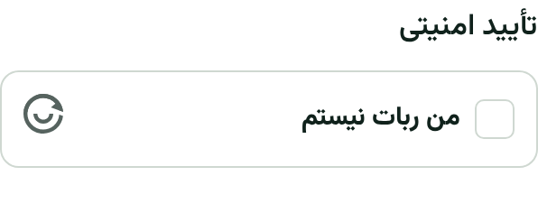
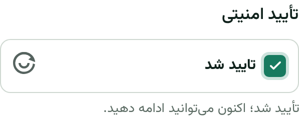

# ALTCHA محلی — پیش‌نمایش مالک RastiSi

شاخه: `codex/altcha-local-20261113`؛ مبنا: `fa416ddbf1ff31652dd7accb9576097fbab0405a` از `kiro/math-captcha-20261111`.
نسخهٔ ریاضی در همان تاریخچه محفوظ است. این شاخه آمادهٔ بررسی محلی مالک است؛ مجوز انتشار Production نیست.

## اجرای Windows / PowerShell

پیش‌نیاز: Git، Python **3.12** با Windows Launcher (`py -3.12`) و Docker Desktop روشن. نصب اول برای دریافت بسته‌ها و تصویر Redis اینترنت می‌خواهد؛ اجرای CAPTCHA پس از نصب، CDN یا سرویس تأیید خارجی نمی‌خواهد.

از پوشهٔ آزمایشی فعلی فقط برای دریافت شاخه و ساخت worktree مجزا استفاده کنید. این دستورها فایل‌ها، محیط Python و دیتابیس CAPTCHA ریاضی فعلی را تغییر نمی‌دهند. مسیر جدید باید از قبل وجود نداشته باشد؛ اگر وجود دارد، نام جدید انتخاب کنید و آن را حذف یا Reset نکنید.

```powershell
$QA = 'D:\Projects\RastiSi\QA_CAPTCHA_20261113'
$Preview = 'D:\Projects\RastiSi\QA_ALTCHA_20261113'
git -C $QA fetch origin codex/altcha-local-20261113
if ($LASTEXITCODE -ne 0) { throw 'Fetch failed' }
git -C $QA worktree add --detach $Preview FETCH_HEAD
if ($LASTEXITCODE -ne 0) { throw 'Worktree creation failed' }
Set-Location $Preview
git rev-parse HEAD
powershell -NoProfile -ExecutionPolicy Bypass -File .\tools\altcha_qa\Start-Preview.ps1
```

گزینهٔ ExecutionPolicy فقط برای همان فرایند است؛ تنظیم سراسری ویندوز تغییر نمی‌کند. اسکریپت با Python 3.12 یک venv مستقل می‌سازد، وابستگی‌ها را نصب می‌کند، Redis مخصوص QA را فقط روی `127.0.0.1:6394` اجرا می‌کند و دیتابیس **جدید** `.altcha-qa/preview.sqlite3` و دادهٔ مرجع صنف‌ها را آماده می‌کند. داده‌ای از دیتابیس قبلی کپی نمی‌شود. هیچ فایل `.env` واقعی لازم نیست.

در مرورگر باز کنید:

- `http://rastisi.localhost:8013/login/` — هر دو زبانهٔ رمز عبور و OTP
- `http://rastisi.localhost:8013/register/`
- `http://rastisi.localhost:8013/reset-password/`
- `http://rastisi.localhost:8013/contact/`

اگر نام `.localhost` resolve نشد، `http://127.0.0.1:8013/login/` را امتحان کنید. HTTP فقط در loopback مجاز است؛ WebCrypto روی سایت واقعی به HTTPS نیاز دارد. پورت را در صورت اشغال با `-Port 8015` تغییر دهید.

در این تنظیمات **فقط QA**، پیامک واقعی ارسال نمی‌شود و کد آزمایشی OTP برابر **123456** است. از شماره و اطلاعات ساختگی استفاده کنید. برای بازیابی رمز ابتدا یک حساب آزمایشی ثبت کنید. CAPTCHA همچنان Proof of Work واقعی و Redis دارد؛ کد OTP ثابت هیچ CAPTCHA را دور نمی‌زند. این تنظیمات با Production، Redis غیرمحلی، `DATABASE_URL` یا `DJANGO_SECRET_KEY` ارث‌رسیده شروع نمی‌شود. در صورت خطای این محافظ‌ها، یک shell محلی بدون متغیرهای واقعی باز کنید؛ Secret را در چت ارسال نکنید.

با Ctrl+C سرور متوقف می‌شود؛ محیط فرایند PowerShell بازیابی می‌شود. Redis مخصوص همین preview را می‌توان با `docker stop rastisi-altcha-qa` متوقف کرد. فایل‌های دیتابیس و worktree حفظ می‌شوند. نیازی به `flushdb`، حذف فایل، checkout شاخهٔ قبلی یا reset نیست.

**چک مالک:** checkbox فارسی سریع دیده شود؛ با کلیک «تأیید شد» نمایش داده شود؛ هر دو زبانهٔ ورود کار کنند؛ ارسال بدون تأیید رد شود و دکمه قفل نشود؛ بعد از خطای فرم دوباره تأیید کنید. لطفاً ظاهر و زمان تأیید را روی لپ‌تاپ و در صورت امکان گوشی واقعی بررسی کنید.

## ساختار و کنترل‌های امنیتی

- کتابخانه‌های رسمی: [`altcha` 2.3.0](https://github.com/altcha-org/altcha-lib-python)، [`altcha-django` 1.1.0](https://github.com/altcha-org/altcha-django)، ویجت [`altcha` 3.6.0](https://github.com/altcha-org/altcha). نسخه‌ها pin شده‌اند. فایل‌های JS، ترجمهٔ رسمی فارسی، مجوز MIT و منشأ همراه SHA-256 داخل `portal/vendor/altcha/3.6.0` هستند؛ تمامیت SHA-512 بستهٔ npm نیز قبل از کپی بررسی شد. CSS ویجت داخل همان JS محلی است و CSS هماهنگی فرم نیز محلی است.
- از `ChallengeConfig`، `build_challenge` و `LocalVerifier` رسمی استفاده می‌شود. اپ و endpoint عمومی آمادهٔ `altcha-django` نصب نشده‌اند: RastiSi endpoint مخصوص نشست/فرم و همان rate limiter قبلی را دارد. مسیرهای Sentinel/Cloud و پذیرش test payload استفاده نمی‌شوند.
- `GET /security/altcha/<action>/` فقط پنج action مشخص را می‌پذیرد؛ موفقیت 200، پایان بودجه 429، Redis ناموجود 503. پاسخ `no-store` و `Vary: Cookie` دارد. PoW فقط با کلیک ایجاد می‌شود؛ نمایش صفحه محاسبهٔ اضافه روی گوشی انجام نمی‌دهد.
- PoW v2 از `PBKDF2/SHA-256` با cost=1000، کلید 32 بایتی و شمارندهٔ تصادفی در بازهٔ 64..127 استفاده می‌کند. یک worker و حداکثر 128 محاسبه، تقریباً 65,000..128,000 دور PBKDF2، بدون حداقل تأخیر مصنوعی. دو HMAC جدا با کلید مشتق‌شده از `SECRET_KEY` موجود، چالش و جواب را تأیید می‌کنند؛ Secret جدید خارجی لازم نیست. با تغییر Secret، چالش‌های در جریان باید دوباره حل شوند.
- Redis فقط digest چالش صادرشده، HMAC اتصال نشست/action، زمان صدور و سقف شمارنده را نگه می‌دارد. nonce تصادفی 128 بیتی است. TTL پیش‌فرض 300 ثانیه در Redis و بررسی سمت سرور اعمال می‌شود. `DEL` اتمیک فقط یک مصرف‌کننده را برنده می‌کند؛ خواندن قبل از آن مجوز محسوب نمی‌شود. هیچ کلیدی دوباره استفاده نمی‌شود. مصرف قبل از بررسی proof است؛ جواب غلط یا نشست/فرم اشتباه نیز چالش را می‌سوزاند.
- payload محدود به 4096 کاراکتر است؛ base64/JSON نامعتبر، کلید تکراری، NaN، شکل نامعتبر، شمارندهٔ نامعتبر، کلید جعلی و چالش تغییرکرده رد می‌شوند. digest دقیق قبل از فراخوانی verifier رسمی بررسی می‌شود تا پارامتر محاسباتی دست‌کاری‌شده به کتابخانه نرسد. HMAC جواب امکان تأیید کم‌هزینه روی سرور را می‌دهد؛ تیک ظاهری یا `altcha=true` کافی نیست.
- کنترل‌های CSRF، IP قابل اعتماد، rate limit، بودجهٔ شماره/شناسه، cooldown، Brute Force و جلوگیری از ارسال انبوه OTP تغییر نکرده‌اند. بودجهٔ CAPTCHA همان 120 بررسی و 600 صدور در 10 دقیقه برای هر IP است. قطع Redis هر درخواست حساس را متوقف می‌کند؛ URL اتصال و payload در لاگ ثبت نمی‌شود. ضدبازپخش در چند thread و چند فرایند مستقل با Redis واقعی بررسی شده است.
- تنظیمات Production همچنان CAPTCHA خاموش و cache غیرمشترک را رد می‌کنند. cost فقط 500..10000 و max_number فقط 64..4096 مجازند؛ تغییر آن‌ها نیاز به اندازه‌گیری دوباره روی گوشی دارد. ریاضی fallback فعال نیست. بدون JavaScript تأیید ممکن نیست و پیام فارسی راهنما نمایش داده می‌شود. کاربر صفحه‌کلید از checkbox استاندارد و label رسمی استفاده می‌کند.

PoW اثبات انسان‌بودن نیست؛ بات قادر به حل آن است. این پروفایل سبک برای کاهش اصطکاک انتخاب شده و محدودیت‌های OTP/شماره/IP دفاع اصلی در برابر هزینه و ارسال انبوه باقی می‌مانند. خطای فرم یا بازگشت از bfcache نیاز به تأیید دوباره دارد.

## شواهد و محدودیت‌های بررسی

[گزارش تست و سرعت](TEST_REPORT.md)، [نمونه‌های خام زمان‌سنجی](browser-results.json) و [بررسی ظاهر قبلی](browser-results-legacy.json).





نمونه‌های دسکتاپ: [قبل](desktop-unverified.png)، [بعد](desktop-verified.png). طراحی legacy نیز [قبل](legacy-unverified.png) و [بعد](legacy-verified.png) بررسی شده است.

Chromium با ترافیک غیرمحلی مسدودشده، نمایش و حل تمام پنج action را انجام داد؛ ارسال واقعی فرم تماس در دیتابیس QA پذیرفته و Replay همان payload رد شد. نمایش legacy و v2 بررسی شد. هیچ تغییر مالی، Migration جدید، تغییر CI/CD، Push روی شاخهٔ Kiro، Merge یا تماس با Production انجام نشده است.

پیش‌نمایش برای تأیید مالک آماده است. گوشی ضعیف واقعی، Safari/Firefox و Windows واقعی در این محیط اجرا نشده‌اند. شبیه‌سازی موبایل/CPU معادل سخت‌افزار واقعی نیست. هنوز هیچ استقرار آزمایشی یا Production انجام نشده است. پیش از استقرار جداگانه باید HTTPS، static MIME/collectstatic و سیاست CSP همان محیط بررسی شوند: اسکریپت‌ها و `connect-src` از همان origin، workerهای `blob:` و CSS تزریقی رسمی لازم‌اند. اگر CSP دارای nonce است، ویجت رسمی از `meta[name="csp-nonce"]` پشتیبانی می‌کند؛ سیاست امنیتی را کورکورانه باز نکنید. این شاخه هیچ تنظیم Nginx/CSP/CI را تغییر نمی‌دهد.

## بازاجرای تست‌ها

فقط از Redis و دیتابیس دورریختنی استفاده کنید؛ تست‌های CAPTCHA cache آزمایشی را پاک می‌کنند. برای تست از Redis DB **15** استفاده شود؛ preview از DB **14** استفاده می‌کند. URL واقعی را استفاده نکنید.

```powershell
$Python = '.\.altcha-qa\venv\Scripts\python.exe'
$env:RASTISI_TEST_REDIS_URL = 'redis://:local-test-altcha@127.0.0.1:6394/15'
& $Python manage.py test apps.portal.tests.test_math_captcha shop_core.tests tools.altcha_qa.test_settings --noinput
```

نام تاریخی `test_math_captcha` برای سازگاری label تست حفظ شده؛ اکنون proof واقعی ALTCHA را با solver رسمی، بدون خواندن کلید امضا، حل می‌کند. هیچ معافیت Known Failure یا غیرفعال‌کردن تست اضافه نشده است. تست رقابت OTP قبلی به PostgreSQL واقعی نیاز دارد و جداگانه روی آن موفق شده است.

ابزار اختیاری مرورگر `tools/altcha_qa/browser-check.cjs` با Playwright اجرا می‌شود؛ مرورگر روی loopback محدود است، ترافیک غیرمحلی را مسدود می‌کند و فقط دادهٔ ساختگی در دیتابیس preview می‌سازد. به نصب Node/Playwright فقط برای همین ابزار نیاز است؛ اجرای عادی برنامه Node لازم ندارد. هر اجرای ابزار دو POST تماس دارد و مشمول rate limit واقعی است؛ اجرای مکرر را با فاصله انجام دهید.

برای Linux/macOS، در worktree جدید و shell محلی بدون Secret/DSN واقعی، همان venv و requirements و Redis loopback را آماده کنید، `DJANGO_DEBUG=true` و `RASTISI_RATE_LIMIT_CACHE_URL=redis://:local-test-altcha@127.0.0.1:6394/14` را تنظیم کنید و `migrate`، `ensure_industry_registry --apply` و `runserver 127.0.0.1:8013` را با `--settings=tools.altcha_qa.settings` اجرا کنید. فقط همین settings دیتابیس مستقل preview را انتخاب می‌کند.
